# Leak-Controlled Evaluation Pipeline for Fracture Detection

An open evaluation pipeline for fracture detection on public radiographs. A ConvNeXt-Tiny classifier is trained on FracAtlas with a leak-controlled five-fold split, scored out of fold at an operating point fixed beforehand at 90% specificity, and then tested without any adjustment on GRAZPEDWRI-DX, a paediatric wrist dataset from a different institution. The model reaches an AUC of 0.92 internally and 0.83 externally, and the external result falls to 0.74 once casted images are removed, because the model learned to treat a cast as a sign of fracture. A set of experiments aimed at small fractures was inconclusive. The code, the audits and the ED simulation are provided so that the same questions can be asked of any other fracture model. This is a research evaluation on public data and not a clinical device.

---

## Background and Motivation

Fracture detection on plain radiographs is one of the most studied applications of deep learning in medical imaging, and many published models report internal AUCs above 0.9. Two questions are asked much less often than they should be. The first is whether the model still works on images from another hospital, another population and another X-ray machine. The second is whether the reported accuracy comes from the fracture or from something that merely travels with it, such as a cast, a metal implant or the way an image was cropped. Both are well-known failure modes of medical imaging models, described in the shortcut learning and cross-site generalisation literature (Geirhos et al., 2020; Zech et al., 2018), and both are easy to miss when a model is only tested on a random split of its own development data.

This repository builds the evaluation, and not a better model. The classifier is deliberately a commodity one. Everything around it is designed to make an optimistic result harder to obtain: near-duplicate images are grouped before splitting, the threshold is fixed on validation data and never touched again, the external test uses patient-level resampling for its intervals, and each audit is written so that it can change the conclusion. The work is similar in spirit to prospective and multi-site evaluations of fracture AI such as SAMURAI-Fracture and FRACT-AI, but it is not the same thing. It uses only public retrospective data, it makes no claim about clinical benefit, and it does not replace the prospective evidence those studies are designed to produce.

---

## Datasets and Preprocessing

The development and audit set is FracAtlas, which contains 4,083 radiographs of which 719 show a fracture (17.6%). The images cover the leg (2,124), hand (1,281), a mixed group (398), hip (179) and shoulder (101), and every fractured image carries a bounding-box annotation. FracAtlas has no patient identifier, so patient-level grouping was not available. Groups were instead built from perceptual-hash near-duplicates together with consecutive multi-scan runs, and whole groups are assigned to a single fold. The external set is GRAZPEDWRI-DX, 20,327 paediatric wrist images from a single Siemens machine, with patient-level grouping available and used for every confidence interval. Its fracture prevalence is 67%, so only AUC, sensitivity and specificity are compared across the two datasets, never predictive values.

<div align="center">

| | FracAtlas (development) | GRAZPEDWRI-DX (external) |
|---|---|---|
| Images | 4,083 | 20,327 |
| Fractured | 719 (17.6%) | about 67% |
| Anatomy | leg, hand, hip, shoulder, mixed | paediatric wrist only |
| Grouping | perceptual-hash near-duplicates and multi-scan runs | patient |
| Role | five-fold training and audits | one-shot external test |

*Table 1: The two datasets*

</div>

Images are converted to 512 x 512 with the aspect ratio preserved by padding. Training uses a light affine and brightness augmentation and no flips, because laterality carries information in some views. Access to the data is through the original publications: FracAtlas (Abedeen et al., 2023) and GRAZPEDWRI-DX (Nagy et al., 2022). The licence terms of both datasets have not been verified by this project and should be checked before any redistribution.

---

## Pipeline

The pipeline runs from raw images to an external verdict in the order shown below. The training stage produces five fold models. Every FracAtlas image is scored by the model that did not train on it, so all internal numbers are out of fold. For each fold the operating threshold is set at 90% specificity on the validation fold, and scores are shifted so that zero is the operating point. The same rule is applied to GRAZPEDWRI-DX without refitting, which is the step that matters most, because refitting a threshold on the target data hides exactly the transfer problem the test is meant to expose.

<div align="center">

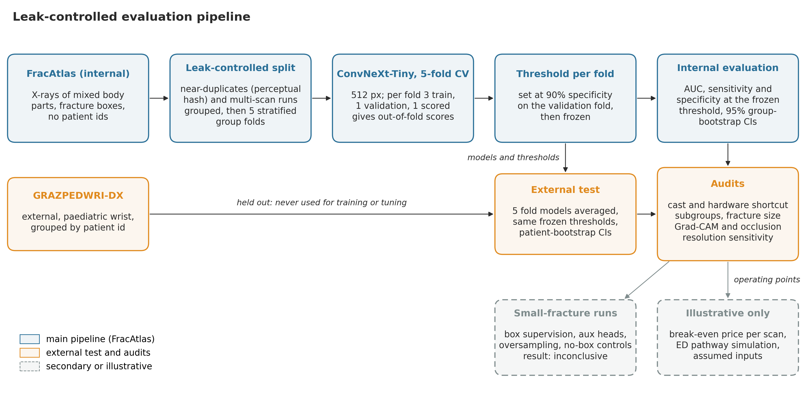

*Figure 1: The evaluation pipeline, from hashing and splitting to the external test, the audits and the illustrative simulation*

</div>

The classifier is a ConvNeXt-Tiny (Liu et al., 2022) pretrained on ImageNet with a single-logit head. It is trained for up to 12 epochs with AdamW (learning rate 1e-4, weight decay 0.05), a one-cycle schedule, a batch size of 16 and early stopping with a patience of 4. Training and evaluation both use five folds, and every interval in the report is a 95% group bootstrap in which whole groups are resampled 1,000 times.

The pipeline also contains Grad-CAM (Selvaraju et al., 2019) and occlusion audits, a resolution test, an auxiliary box-supervision head used in the small-fracture experiments, and a break-even and ED pathway simulation. Each lives in its own script under `FractureDetection/scripts/`, and the shared logic is in `FractureDetection/fracai/`.

<div align="center">

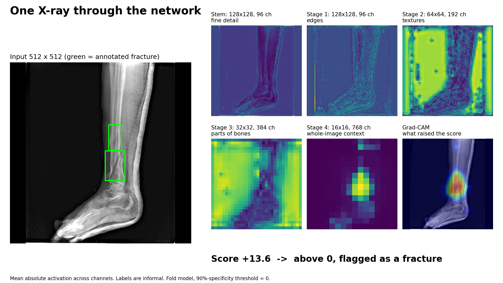

*Figure 2: One detected fracture through the stem and the four stages of the network, ending on the Grad-CAM overlay. Stage labels are informal and the maps show mean absolute activation*

</div>

---

## Results

### Internal performance

On the leak-controlled FracAtlas split the model reaches an AUC of 0.923 (95% CI 0.910 to 0.935). At the fixed operating point its sensitivity is 0.808 and its specificity 0.897. Two checks show that this is not driven by an obvious shortcut. Removing hardware-flagged images moves the AUC only to 0.915 (0.899 to 0.928), and the hardware flag alone predicts the label at an AUC of 0.567, so the apparent skill is not explained by implants. The image-size class alone gives 0.536. The sensitivity falls to 72.2% (65.6 to 78.8) for the smallest quartile of fractures, measured by the longer side of the box, against 87.2% for the largest quartile.

A naive split gave an AUC of 0.931 against 0.923 for the controlled one, with overlapping intervals. Because these were single runs with different fold assignments, no leakage inflation is claimed from this comparison. Hip and shoulder each have only 10 fractured images, and their subgroup numbers should be treated as unreliable.

### External transfer

On GRAZPEDWRI-DX the same model, with the same threshold rule and no refitting, reaches an AUC of 0.825 (0.816 to 0.833). The drop is larger than it first appears, because the external set contains many casted images that the model flags almost regardless of the label.

<div align="center">

| Subset | AUC | Sensitivity | Specificity |
|---|---|---|---|
| FracAtlas hand, internal | 0.899 (0.876 to 0.920) | 0.866 | 0.742 |
| GRAZ, all images | 0.825 (0.816 to 0.833) | 0.776 | 0.749 |
| GRAZ, no cast and no metal | 0.744 (0.735 to 0.753) | 0.61 | 0.79 |
| GRAZ, initial exams only | 0.697 (0.687 to 0.707) | 0.540 | 0.790 |
| GRAZ, cast present (96% fractured) | 0.560 | 0.995 | 0.017 |

*Table 2: Internal and external performance at the pre-fixed operating point*

</div>

Moving from all images to initial exams, which is the situation in which a clinician would actually want a second reader, lowers the AUC from 0.825 to 0.697 and the sensitivity from 0.776 to 0.540. Refitting the threshold on GRAZPEDWRI-DX itself gives a sensitivity of only 0.673 at 90% specificity, so the ranking transfers poorly and not just the threshold. The five fold models disagree among themselves (external AUC 0.75 to 0.83), which means that a single trained model gives an unstable external estimate.

<div align="center">

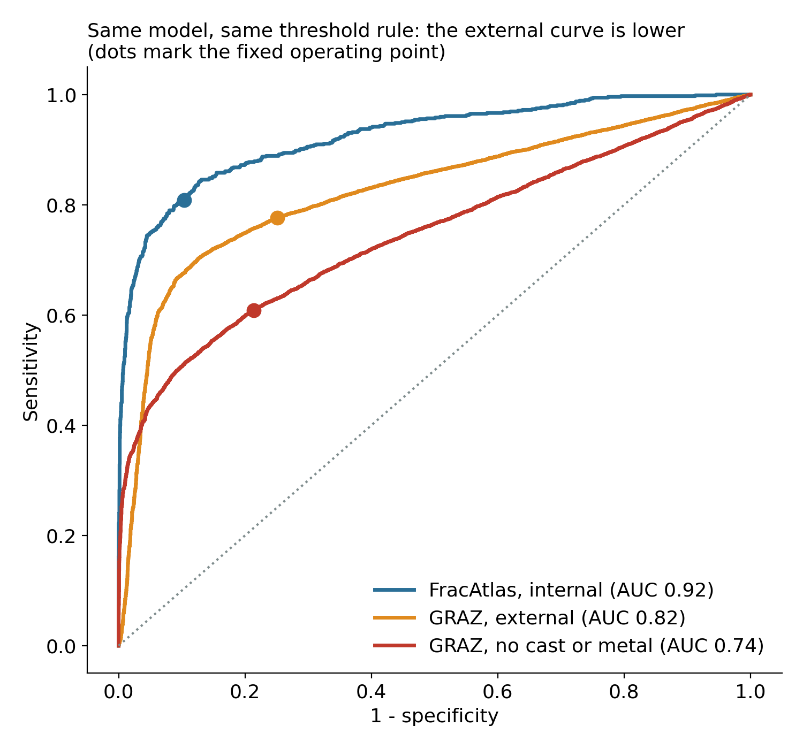

*Figure 3: ROC curves for FracAtlas (internal), GRAZ (external) and GRAZ without cast or metal. Dots mark the fixed operating point*

</div>

### The cast shortcut

Among casted images the model flags 99.5% of fractured cases and also nearly every non-fractured one, with a specificity of 0.017. A cast shifts the score regardless of the label: the mean logit is +7.7 for the 237 non-fractured casted images and +5.3 for the fractured ones, whereas the fracture effect itself among uncasted images is about 2.8. FracAtlas has no cast label, so this shortcut cannot be seen during internal evaluation. It also explains why follow-up visits look better than first visits: among fractured images the flag rate is 54% at first visits and 90% at follow-ups.

<div align="center">

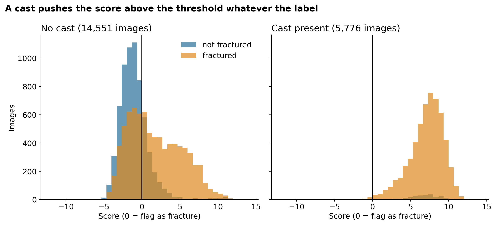

*Figure 4: Score distributions without and with a cast. The vertical line is the operating point*

</div>

### View and fracture type

Frontal views are the weakest: for initial exams the AUC is 0.61 with a sensitivity of 31%, against 0.79 and 73% for lateral views. The cause was not tested. Combining the two views of the same study did not help with the two simple rules tried (AUC 0.775 for the maximum and 0.743 for the mean, against 0.785 for the lateral view alone), although a model trained on paired views could do better. By fracture type, the sensitivity on first visits is 51% for the most common class (AO 23r-M, 3,173 images), 67% for 23-M and 79% for 22r-D, which has only 62 images. All of these analyses are post hoc, and they used the threshold fixed in advance.

### Does the model look at the fracture?

Grad-CAM peaks inside the annotated box for 63.7% (59.6 to 67.8) of detected fractures and only 29.7% (22.3 to 38.1) of missed ones, against a chance level of about 3%. An occlusion test on 581 detected fractures supports this: covering the fracture lowers the score by 2.42 logits (2.13 to 2.72), against 0.01 for a control patch, and the fracture cover hurt more than the control in 77% of cases (73 to 80%). Two caveats apply. In 86% of cases the image is still flagged after the fracture is covered, so the score is not carried by the fracture alone, and the control patch is not guaranteed to lie on bone. Saliency is useful for review and is not proof of mechanism.

<div align="center">

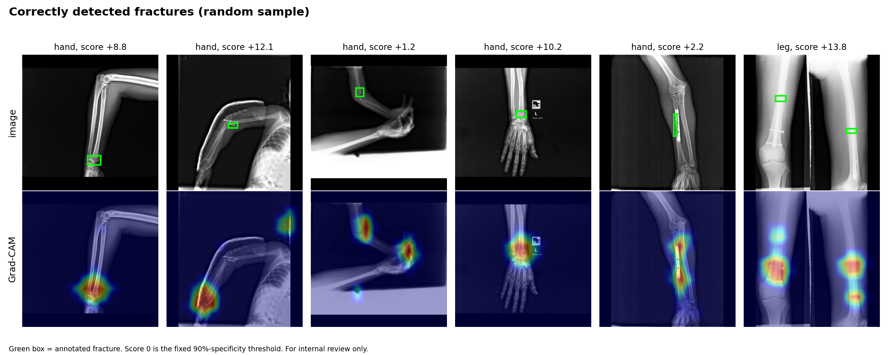

*Figure 5: Correctly detected fractures, with the annotated box in green and the Grad-CAM overlay below. Random sample*

</div>

<div align="center">

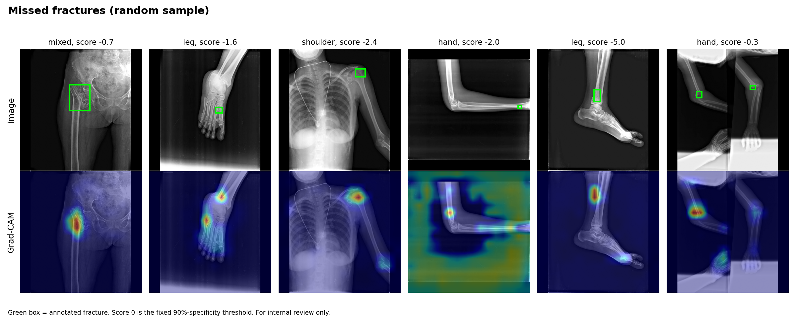

*Figure 6: Missed fractures, sampled at random*

</div>

<div align="center">

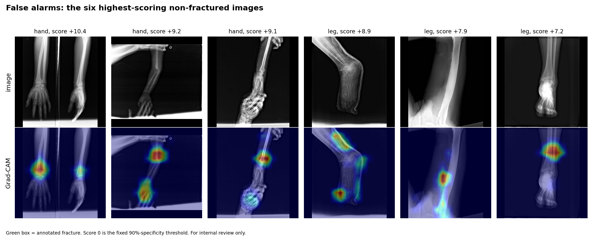

*Figure 7: The six highest-scoring non-fractured images, which are the model's most confident false alarms*

</div>

---

## Small Fractures

The smallest quartile of fractures by relative box area (180 images) is detected less often than the rest, and the question was whether supervising the model with the annotated boxes would help. The experiments added an auxiliary head, with and without box supervision, at several box fractions, a finer localisation head, and oversampling of small fractures. The baseline was run with two seeds. Resolution was ruled out as the cause: blurring images down to 128 pixels does not reduce small-fracture sensitivity, and upscaling beyond the native resolution adds nothing.

<div align="center">

| Run | AUC | Small-fracture sensitivity | Difference from seed-43 baseline |
|---|---|---|---|
| Baseline, seed 42 | 0.923 | 0.761 (0.693 to 0.822) | |
| Baseline, seed 43 | 0.932 | 0.794 (0.735 to 0.854) | |
| Auxiliary head, no boxes (control) | 0.935 | 0.806 | +0.011 (-0.033 to +0.052) |
| Boxes on 100% of fractured images | 0.936 | 0.833 (0.773 to 0.885) | +0.039 (-0.005 to +0.078) |
| Boxes on 25% | 0.932 | 0.800 | +0.006 (-0.043 to +0.051) |
| Boxes on 10% | 0.938 | 0.828 (0.769 to 0.886) | +0.033 (-0.018 to +0.078) |
| Fine head, boxes on 100% | 0.939 | 0.828 (0.770 to 0.881) | +0.033 (-0.013 to +0.080) |
| Fine head, no boxes (control) | 0.936 | 0.794 | +0.000 (-0.045 to +0.045) |
| Oversample small x3 | 0.932 | 0.761 (0.688 to 0.826) | -0.033 (-0.086 to +0.015) |

*Table 3: Sensitivity on the smallest-fracture quartile at the fixed operating point, with paired 95% intervals*

</div>

The honest reading is that the experiment is inconclusive, and it should not be read as showing no effect. Against the better of the two baselines, the strict rule, no run clears zero, and no box run beats its own no-box control. Yet every auxiliary or box variant has a positive point estimate, and against the mean of the two baselines three box runs have intervals above zero, although that comparison is exploratory and was chosen after the results were seen. The two baseline seeds differ by 0.033 with no change at all to the method, so the gains of 0.03 to 0.05 seen here are the same size as seed variation. With 180 images the paired half-width is about 0.045, so only differences of about 0.065 or more are detectable in principle, before run-to-run variance is counted. A proper test needs three to five seeds for each arm, and that has not been run.

<div align="center">

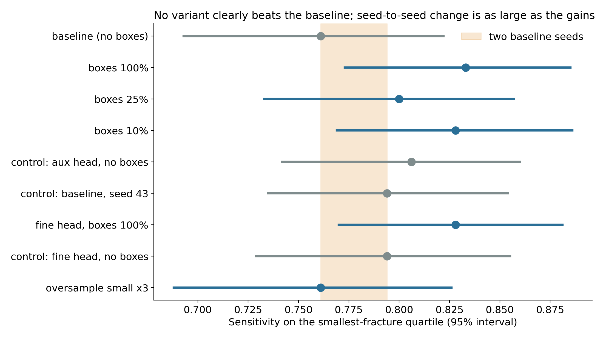

*Figure 8: Small-fracture sensitivity by run with 95% intervals. The shaded band spans the two baseline seeds*

</div>

<div align="center">

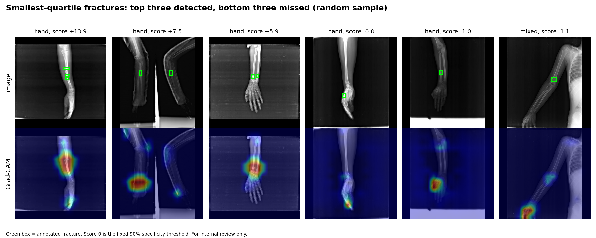

*Figure 9: Smallest-quartile fractures, three detected (left) and three missed (right), random sample*

</div>

<div align="center">

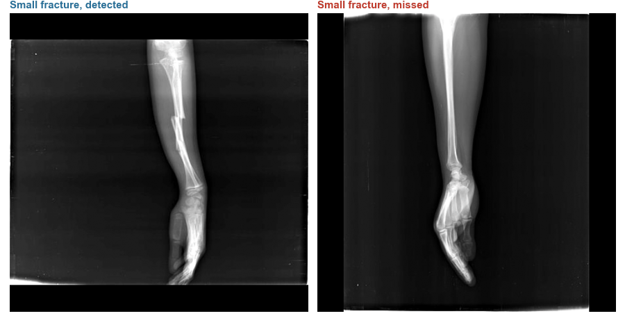

*Figure 10: A detected and a missed small fracture. The annotated box appears first and the Grad-CAM heatmap follows. In the missed case the heatmap sits away from the box*

</div>

---

## Illustrative ED Simulation

To ask what an operating point might mean in practice, a discrete-event simulation models one typical English major emergency department for a year with a single reporter. It is labelled illustrative because most of its inputs are assumptions. Only the national volume is taken from NHS England data (1.503 million Type 1 attendances in September 2026). The 120 departments, the 12% share of attendances that have a limb X-ray, a fracture prevalence of 20%, a daytime-peaked arrival pattern, one reporter working nine hours a day at 75% or 95% load, a usual miss rate of 5% and an 0.8 chance that an alert corrects a miss are all assumed, and the independence of AI and clinician errors is optimistic.

Under those assumptions the internal operating point (sensitivity 0.81, specificity 0.90) catches 109 of about 182 missed fractures a year when used as an alert, at the cost of about 12 extra re-reads a day. The external first-visit point (sensitivity 0.54, specificity 0.79) catches 71 and produces 13.5 re-reads a day, so it finds about a third fewer misses and roughly doubles the false alarms. Triage helps little when the reporter has spare time and more when the reporter is busy: at 95% load it lowers the undetected fracture-hours from 1,760 to 1,110. The harm of false alerts, the clinician time they cost, patient harm from delay, appointment capacity and real rosters are not modelled.

<div align="center">

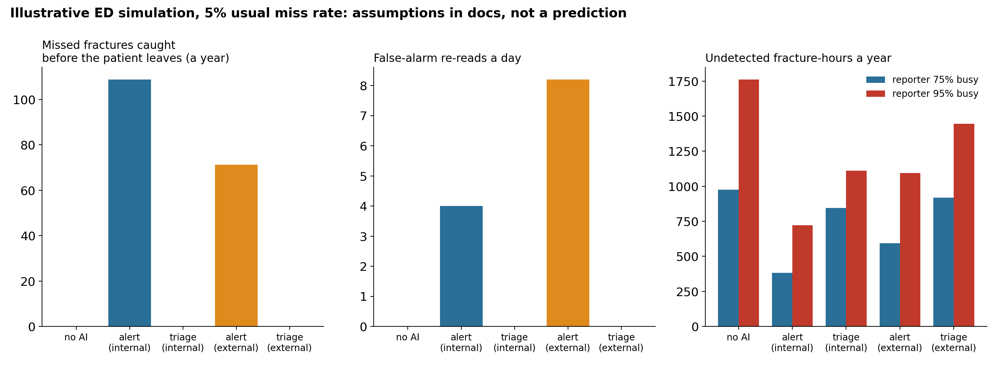

*Figure 11: Illustrative ED simulation at a 5% usual miss rate. A comparison of assumptions and not a prediction*

</div>

The simulation is site-parameterised, with functions that calibrate arrivals, shift pattern and reporting time from timestamps and validate them on a held-out period against tolerances fixed beforehand. On synthetic data generated by the same code from a hidden site, the calibration recovered the site and the validation passed, but that test is circular: it shows that the fitting works on a correctly specified model and says nothing about a real hospital. The model would become a digital twin of a real site only after calibration and validation on that site's own data, and prevalence, miss rate and alert catch probability cannot be learned from timestamps. A companion break-even analysis, in which costs and usual miss rates are grid axes and nothing is sourced, shows only that external performance and not internal performance decides whether any price per scan is viable.

<div align="center">

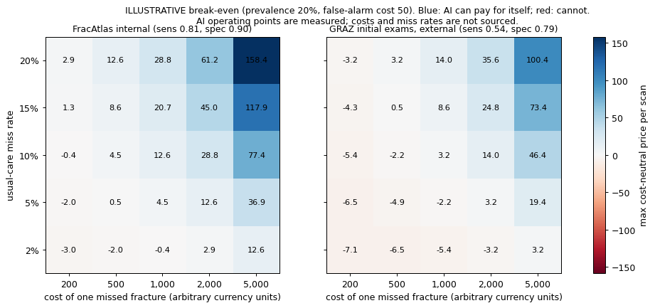

*Figure 12: Illustrative break-even grid. Costs and usual miss rates are axes and none of the values are sourced*

</div>

---

## Key Findings

1. **Internal accuracy overstates what a deployed model would do.** The AUC of 0.92 on FracAtlas falls to 0.83 on GRAZPEDWRI-DX and to 0.70 on initial exams, where the sensitivity at the pre-fixed threshold is 0.54. A model evaluated only on a random split of its own source data would not reveal this.

2. **Part of the external performance is a shortcut.** The model treats a cast as evidence of fracture, a signal that is invisible in the development data because FracAtlas has no cast label. External results should always be reported with and without treatment artefacts, and a model should be audited for them before its sensitivity is quoted.

3. **Saliency supports the model on average and not in every case.** Heatmaps and occlusion agree that the model usually uses the fracture region, but 86% of occluded cases are still flagged, so the score is not carried by the fracture alone. Saliency is evidence to review and is not a proof of mechanism.

4. **The small-fracture question is open.** Box supervision shows a consistent positive direction and no run beats its control by the strict rule. The seed-to-seed change in the baseline is as large as the gains, so the result is inconclusive, and a multi-seed experiment is needed to settle it.

5. **The operating point matters in the simulation.** Under stated assumptions the external point catches about a third fewer misses than the internal point and doubles the false alarms, and workload effects depend strongly on how busy the reporter is. These are illustrations of why the external figure should be used for planning and not the internal one.

---

## Limitations and Future Work

Every setting was trained once, with one extra seed for the baseline only, so run-to-run variance is not estimated and individual intervals understate the uncertainty. FracAtlas has no patient identifiers, so residual leakage between near-identical images is possible even after hash-based grouping, and the comparison of naive and controlled splits cannot show how large it is. GRAZPEDWRI-DX covers paediatric wrist images from a single Siemens machine, which makes a device shortcut untestable, while FracAtlas mixes body parts and has few hand positives (381). The provenance of the GRAZ `fracture_visible` label was not checked, and the licences of both datasets are unverified. The simulation rests on assumptions and the break-even analysis is illustrative, so neither is evidence about clinical benefit.

Several extensions would be worth doing. The decisive small-fracture test needs three to five seeds per arm. Training at a higher resolution and training with GRAZPEDWRI-DX patients included were not tried. A stricter same-bone occlusion control would remove one caveat from the saliency audit, and a model trained on paired frontal and lateral views could change the view analysis. Calibrating the simulation on real timestamps from a single site would be the step that turns the machinery into a genuine twin. Prospective multi-site evaluation of the kind carried out in SAMURAI-Fracture and FRACT-AI remains the standard against which any such system should be judged.

---

## Repository Layout and Reproduction

All code is in `FractureDetection/`. The `fracai/` package holds the library code (data, split, training, metrics, audit, break-even, simulation), `scripts/` has one folder each for data preparation, training, audits, analysis and simulation, `jobs/` has the resumable shell runners, and `docs/` holds the analysis plan, limitations, data licence notes and the paper draft with its PDF. The unit tests run with `pytest`.

```
cd FractureDetection
python -m venv .venv
.venv/Scripts/python -m pip install -r requirements.txt
```

Run every script from the `FractureDetection` folder with `PYTHONPATH=.` in this order: the data scripts (hashing, split, image caches, weights), `bash jobs/run_training.sh`, the box and audit scripts, the control and small-fracture runs, the analysis scripts, and finally the simulation. Datasets and model weights are not included and have to be downloaded from their original sources. Audits re-run from saved score files matched exactly in a clean copy. A full retraining end to end has not been repeated.

---

## References

1. Abedeen et al. (2023). FracAtlas: A Dataset for Fracture Classification, Localization and Segmentation of Musculoskeletal Radiographs. Scientific Data 10.
2. Nagy et al. (2022). A pediatric wrist trauma X-ray dataset (GRAZPEDWRI-DX) for machine learning. Scientific Data 9.
3. Liu et al. (2022). A ConvNet for the 2020s. CVPR 2022.
4. Selvaraju et al. (2019). Grad-CAM: Visual Explanations from Deep Networks via Gradient-Based Localization. International Journal of Computer Vision 128.
5. Geirhos et al. (2020). Shortcut learning in deep neural networks. Nature Machine Intelligence 2.
6. Zech et al. (2018). Variable generalization performance of a deep learning model to detect pneumonia in chest radiographs: a cross-sectional study. PLOS Medicine 15.
7. Ju and Cai (2023). Fracture detection in pediatric wrist trauma X-ray images using YOLOv8 algorithm. Scientific Reports 13.
8. Zech et al. (2023). Detecting pediatric wrist fractures using deep-learning-based object detection. Pediatric Radiology 53.
9. Yoon et al. (2021). Development and Validation of a Deep Learning Model Using Convolutional Neural Networks to Identify Scaphoid Fractures in Radiographs. JAMA Network Open 4.

---

## Author

Navin Bondade
MSc Health Data Science, University College London
