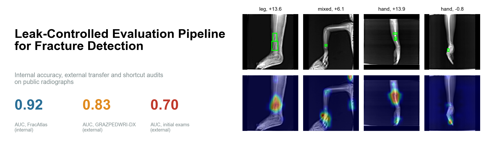

<div align="center">



</div>

# Leak-Controlled Fracture Detection & Evaluation

How much of the accuracy reported for fracture-detection models is a property of the model, and how much is a property of the way it was evaluated? This repository answers that question for one concrete case. A standard ConvNeXt-Tiny classifier is trained on the public FracAtlas dataset under a split that keeps near-duplicate images together, its decision threshold is fixed in advance at 90% specificity, and it is then applied without any retraining or threshold change to GRAZPEDWRI-DX, a paediatric wrist dataset from a different institution. The same model scores an AUC of 0.923 on its own data, 0.825 on the external data, 0.744 once images with a cast or metal are removed, and 0.697 on first-visit examinations. Most of the gap between the external headline and the cleaner subsets is explained by a shortcut: the model treats a plaster cast as evidence of fracture. The result is not a better fracture detector. It is a measured account of how far a strong internal number can fall when the evaluation is designed to make an optimistic result hard to obtain.

### Contributions

Compared with an evaluation confined to a random split of FracAtlas, this work differs in three concrete ways.

1. **Leakage and threshold control.** Near-duplicate radiographs are grouped before splitting, every FracAtlas image is scored by a model that never saw it, and the operating threshold is fixed on validation data and never refitted, including on the external set.
2. **External transfer with artefact audits.** The model is tested on 20,327 external images with patient-level confidence intervals, and the external result is broken down by cast, metal, first visit, view and fracture type, which exposes a cast shortcut that the development data cannot reveal.
3. **Reproducible audits of what the measurements can and cannot resolve.** The pipeline includes saliency and occlusion audits, a resolution test, a pre-written decision rule for a small-fracture intervention, and an illustrative emergency-department (ED) simulation, all released as code so the same questions can be asked of any other fracture model.

### What this work does not show

This is a retrospective evaluation on public data and not a clinical validation. It does not show that the model would help clinicians, and it is not a medical device. The small-fracture experiments are inconclusive: the unmodified model changed by 0.033 in small-fracture sensitivity between two random seeds, which is as large as the gains being tested, so the main finding of that section is about how many repeated runs such a claim needs. The ED simulation uses assumed inputs (for example 120 departments and a 5% usual miss rate) and illustrates a mechanism; it predicts nothing about any real hospital.

The rest of the report follows the argument in order: why existing numbers are hard to trust, how the data and evaluation were set up, what the model achieves internally and externally, where it fails and why, what the small-fracture and simulation experiments can and cannot say, and what remains unknown.

---

## Background and Motivation

Fracture detection on plain radiographs is one of the most studied applications of deep learning in medical imaging, and many published models report internal AUCs above 0.9. Detection models have been trained and evaluated on paediatric wrist radiographs [7, 8], and two-stage designs have been proposed for subtle fractures such as those of the scaphoid [9]. Two questions are asked much less often than they should be. The first is whether a model still works on images from another hospital, another population and another X-ray machine. The second is whether the reported accuracy comes from the fracture itself or from something that merely travels with it, such as a cast, a metal implant or the way an image was cropped. Both are well-known failure modes of medical imaging models, described in the shortcut-learning [5] and cross-site generalisation [6] literature, and both are easy to miss when a model is only tested on a random split of its own development data.

A random split adds a third, quieter problem. FracAtlas has no patient identifiers, and some of its images are near-identical scans of the same limb. If one copy is used for training and another for testing, the test measures recall of a seen image rather than detection of an unseen fracture. We call this leakage.

This repository therefore builds the evaluation, not a better model. The classifier is deliberately a commodity one. Everything around it is designed to make an optimistic result harder to obtain: near-duplicates are grouped before splitting, the threshold is fixed on validation data and never touched again, the external test uses patient-level resampling for its intervals, and each audit is written so that it could change the conclusion. The work is similar in spirit to prospective and multi-site evaluations of fracture AI, but it is not the same thing. It uses only public retrospective data, it makes no claim about clinical benefit, and it does not replace the prospective evidence those studies are designed to produce. The next section describes the two datasets and how each was grouped, since the grouping determines what every later confidence interval means.

---

## Datasets and Preprocessing

The development and audit set is FracAtlas [1], which contains 4,083 radiographs, of which 719 show a fracture (17.6%). The images cover the leg (2,124), hand (1,281), a mixed group in which several body parts are labelled (398), hip (179) and shoulder (101), and every fractured image carries a bounding-box annotation of the fracture. Because FracAtlas has no patient identifier, patient-level grouping is not possible. Groups were instead formed by linking any two images whose 256-bit perceptual hashes differ by at most 30 bits, and by linking consecutive images that are both flagged as multi-scan and share a body part. This produces 3,828 groups, of which 178 contain more than one image. Whole groups are assigned to a single fold, using five folds stratified by label and body part.

The external set is GRAZPEDWRI-DX [2], 20,327 paediatric wrist images from 6,091 patients, all acquired on a single Siemens machine. The fracture label is the dataset's `fracture_visible` field (a blank field is read as no fracture), which gives 13,550 fractured images (66.7%). Patient identifiers are available, so every external confidence interval resamples whole patients. Because fracture prevalence differs so much between the datasets (17.6% against 66.7%), only AUC, sensitivity and specificity are compared across them; predictive values would mostly reflect prevalence. Table 1 summarises the two sets.

<div align="center">

| | FracAtlas (development) | GRAZPEDWRI-DX (external) |
|---|---|---|
| Images | 4,083 | 20,327 |
| Fractured | 719 (17.6%) | 13,550 (66.7%) |
| Anatomy | leg, hand, hip, shoulder, mixed | paediatric wrist only |
| Grouping | perceptual-hash near-duplicates and multi-scan runs (3,828 groups) | patient (6,091 patients) |
| Role | five-fold training and audits | one-shot external test |

<b>Table 1.</b> The two datasets. Groups are the units that are kept within one fold and resampled in every bootstrap interval

</div>

Images are resized so that the longer side is 512 pixels and padded to 512 x 512, which preserves the aspect ratio. Training uses a light augmentation (rotation up to 10 degrees, scaling up to 10%, small translations, and brightness and contrast changes) and no flips, because laterality carries information in some views. Access to the data is through the original publications [1, 2]. The licence terms of both datasets have not been verified by this project and should be checked before any redistribution. With the data fixed, the next section describes how a score becomes a decision, which is where most of the evaluation design lies.

---

## Pipeline

The pipeline runs from raw images to an external verdict in the order shown in Figure 1. It is built around one principle: no number reported here was produced by a model, or a threshold, that had seen the images being scored.

<div align="center">

<p align="center">

<br>
<b>Figure 1.</b> The evaluation pipeline, from near-duplicate hashing and group splitting to the external test, the audits and the illustrative simulation
</p>
<br>

</div>

Training uses five folds. For fold k, the model is trained on three folds, uses fold (k+1) mod 5 for early stopping and threshold setting, and is tested on fold k. Each FracAtlas image is therefore scored exactly once, by the one model that neither trained on it nor used it for validation. These are the out-of-fold scores on which all internal results are computed, over all 4,083 images.

The **operating point** is the decision threshold, and it is fixed before any test data is seen. For each fold model it is the lowest score at which specificity on that model's validation fold reaches 90%. Each model's scores are then shifted so that its threshold sits at zero, and an image is **flagged** (called fractured) when its shifted score is zero or above. A fractured image that is flagged is **detected**; a fractured image that is not flagged is **missed**. On GRAZPEDWRI-DX the external score of an image is the mean of the five fold models' shifted scores, flagged by the same rule, with no refitting of any kind. This step matters most, because refitting a threshold on the target data hides exactly the transfer problem the test is meant to expose.

The classifier is a ConvNeXt-Tiny [3] pretrained on ImageNet, with a single input channel and a single-logit output. It is trained for up to 12 epochs with AdamW (learning rate 1e-4, weight decay 0.05), a one-cycle learning-rate schedule and a batch size of 16, and training stops early when validation AUC has not improved for 4 epochs. Every interval in this report is a 95% percentile bootstrap with 1,000 draws in which whole groups are resampled: FracAtlas near-duplicate groups internally and patients externally. When two training runs are compared, the same resampled groups are used for both, which gives a paired interval for their difference.

Around this core the pipeline adds Grad-CAM [4] and occlusion audits, a resolution test, an auxiliary box-supervision head used in the small-fracture experiments, and a break-even analysis and ED pathway simulation. Each lives in its own script under `FractureDetection/scripts/`, and the shared logic is in `FractureDetection/fracai/`. Figure 2 shows what the network computes on a single image before any of these audits are applied.

<div align="center">

<p align="center">

<br>
<b>Figure 2.</b> One detected fracture traced through the stem and the four stages of the network, ending on the Grad-CAM overlay. Stage labels are informal and the maps show mean absolute activation
</p>
<br>

</div>

The figure is a visual guide rather than evidence; whether the model attends to the fracture is tested quantitatively later. The results begin with the number most papers would stop at, the internal score.

---

## Results

### Internal performance

On the leak-controlled FracAtlas split the out-of-fold AUC is 0.923 (95% CI 0.910 to 0.935), computed on all 4,083 images. At the fixed operating point sensitivity is 0.808 (581 of 719 fractures detected) and specificity is 0.897. Two checks suggest that this figure is not driven by an obvious shortcut. FracAtlas marks 99 images as containing hardware (metal implants), 97 of them fractured. Removing them moves the AUC only to 0.915 (0.899 to 0.928), and the hardware flag used alone as a predictor reaches an AUC of only 0.567. A predictor that uses only the image-size class reaches 0.536.

Performance is not uniform across fractures. Ranking the 719 fractured images by the longer side of their annotated box, the smallest quartile (180 images) is detected 72.2% of the time (65.6 to 78.8), against 87.2% for the largest quartile. This gap motivates the small-fracture experiments later in the report.

Grouping matters for credibility, but its effect on this dataset could not be measured precisely. A naive split that assigns images to folds at random, ignoring near-duplicate groups, gave an AUC of 0.931 against 0.923 for the controlled split, with overlapping intervals. Because each split was trained once and the two use different fold assignments, no leakage inflation is claimed from this comparison. Subgroups with fewer than 30 fractured or 30 non-fractured images are flagged as unreliable; hip and shoulder each have only 10 fractured images and fall in this category.

By this standard the internal result is strong. The question is whether it survives a change of hospital, population and scanner.

### External transfer

On GRAZPEDWRI-DX, with the same five models, the same threshold rule and no refitting, the AUC is 0.825 (0.816 to 0.833). Read alone this looks like a modest drop. Table 2 shows that it is not. The first row gives the closest internal comparison, the 1,281 FracAtlas hand images, and the remaining rows break the external set into subsets defined by labels supplied with GRAZPEDWRI-DX: **cast** and **metal** are the dataset's `cast` and `metal` annotations, and **initial exams** are images whose `initial_exam` field equals 1 (10,861 images from 4,929 patients, 42% fractured). Images with a blank `initial_exam` field (9,466) are treated as follow-ups, which is an assumption.

<div align="center">

| Subset | AUC | Sensitivity | Specificity |
|---|---|---|---|
| FracAtlas hand, internal | 0.899 (0.876 to 0.920) | 0.866 | 0.742 |
| GRAZ, all images | 0.825 (0.816 to 0.833) | 0.776 | 0.749 |
| GRAZ, no cast and no metal | 0.744 (0.735 to 0.753) | 0.61 | 0.79 |
| GRAZ, initial exams only | 0.697 (0.687 to 0.707) | 0.540 | 0.790 |
| GRAZ, cast present (96% fractured) | 0.560 | 0.995 | 0.017 |

<b>Table 2.</b> Internal and external performance at the operating point fixed on FracAtlas validation folds. Intervals are 95% group bootstrap (FracAtlas groups for the first row, GRAZPEDWRI-DX patients for the rest)

</div>

Removing the 6,214 images that carry a cast or metal leaves 14,113 images, and the AUC falls from 0.825 to 0.744. Restricting to initial exams, the situation in which a clinician would actually want a second reader, lowers it further to 0.697, with a sensitivity of 0.540. Almost no initial exam carries a cast (2 of 10,861 images) or metal (17), so the further fall from 0.744 to 0.697 is not a cast effect; it reflects that first-visit fractures are harder for this model than the mixture of first and follow-up images that remains after removing casts.

Two further checks show that the problem is the model's ranking of images and not only its threshold. Refitting the threshold on GRAZPEDWRI-DX itself to give 90% specificity, a step that is deliberately excluded from the main analysis, yields a sensitivity of only 0.673. And the five fold models, scored individually, give external AUCs from 0.753 to 0.833, so a single trained model would have given an unstable external estimate; the averaged score reported in Table 2 (0.825) is higher than four of the five individual models. Figure 3 shows the same contrast as full ROC curves.

<div align="center">

<p align="center">

<br>
<b>Figure 3.</b> ROC curves for FracAtlas (internal, out of fold), GRAZPEDWRI-DX (external, all images) and GRAZPEDWRI-DX without cast or metal. Dots mark the operating point fixed in advance
</p>
<br>

</div>

The external curve without casts or metal lies clearly below the full external curve, which means that casted and metal-containing images were raising the headline number. The next section shows why.

### The cast shortcut

Among the 5,776 casted images (96% fractured), the model flags 99.5% of the fractured ones and also nearly all of the non-fractured ones, a specificity of 0.017. The model is therefore not detecting fractures in casted wrists; it is detecting casts. Comparing mean scores within each label makes this explicit. Among non-fractured images, the 237 with a cast score on average 7.7 logits higher than the 6,540 without. Among fractured images, a cast raises the mean score by 5.3 logits. For comparison, the effect of the fracture itself, the difference in mean score between fractured and non-fractured images without a cast, is only about 2.8 logits. A cast moves the score more than a fracture does.

<div align="center">

<p align="center">

<br>
<b>Figure 4.</b> Distributions of the external score for images without and with a cast. The vertical line is the operating point
</p>
<br>

</div>

Figure 4 shows that almost the entire casted distribution lies above the operating point, whatever the label. This is a textbook shortcut in the sense of [5]: a feature that correlates with the label in the data but is not the property of interest. It is invisible during internal evaluation because FracAtlas has no cast label, so no FracAtlas audit could have found it. The same shortcut explains why follow-up visits look better than first visits: among fractured images, 54% are flagged at first visits and 90% at follow-ups, where casts are common. Having separated out the cast effect, the remaining question is which first-visit fractures the model misses.

### View and fracture type

On initial exams the model is weakest on frontal views, with an AUC of 0.61 and a sensitivity of 31% (5,370 images), against 0.79 and 73% for lateral views (5,439 images). The cause was not tested. A natural remedy is to combine the two views of the same study. This was tested on the 4,951 first-visit studies that have both views, where the lateral view alone gives an AUC of 0.785 (0.773 to 0.796) and the frontal view alone 0.580. Neither simple combination rule helped: taking the maximum of the two scores gave 0.775 and the mean gave 0.743. A model trained on paired views might do better, but that was not tried.

By fracture type, using the AO classification supplied with GRAZPEDWRI-DX (truncated to its bone and type prefix, and shown only for classes with at least 30 patients), first-visit sensitivity is 51% for the most common class, 23r-M (3,173 images), 67% for 23-M, 49% for 23r-E and 79% for 22r-D (62 images). All analyses in this subsection are post hoc, and all use the threshold fixed in advance. Since the model fails on many first-visit fractures, it is worth asking whether, when it succeeds, it is looking at the fracture.

### Does the model look at the fracture?

This audit returns to FracAtlas, where every fracture has an annotated box. For each fractured image, Grad-CAM is computed on the last stage of the fold model that scored it, and the audit records whether the heatmap's single highest point (its peak) falls inside an annotated box enlarged by 16 pixels on each side. The peak falls inside the box for 63.7% (59.6 to 67.8) of the 581 detected fractures and only 29.7% (22.3 to 38.1) of the 138 missed ones. The chance level, the share of the image covered by the enlarged boxes, averages about 3%.

An occlusion test on the 581 detected fractures checks the same question by intervention. Covering the annotated fracture with the image's median grey lowers the score by 2.42 logits on average (2.13 to 2.72), whereas covering up to five same-sized control patches, placed at random on bright (tissue or bone) areas away from the fracture, changes it by -0.01. Covering the fracture hurts the score more than the control patches in 77% of cases (73 to 80%). Two caveats apply. After the fracture is covered, 86% of these images are still flagged, so the decision is not carried by the fracture region alone. And the control patch is chosen by brightness, so it is not guaranteed to lie on bone. Saliency is useful for review and is not proof of mechanism. Figures 5 to 7 show what these numbers look like on individual images.

<div align="center">

<p align="center">

<br>
<b>Figure 5.</b> Correctly detected fractures, randomly sampled, with the annotated box in green and the Grad-CAM overlay below
</p>
<br>

</div>

<div align="center">

<p align="center">

<br>
<b>Figure 6.</b> Missed fractures (fractured images scored below the operating point), randomly sampled
</p>
<br>

</div>

<div align="center">

<p align="center">

<br>
<b>Figure 7.</b> The six highest-scoring non-fractured images, which are the model's most confident false alarms
</p>
<br>

</div>

The random samples in Figures 5 and 6 are consistent with the pointing rates above: heatmaps for detected fractures tend to sit on the box, while those for missed fractures often do not. Many of the missed fractures are small, which leads to the one intervention this work attempted.

---

## Small Fractures

The internal results showed that small fractures are detected less often. This section asks whether that gap can be closed, and, as it turned out, whether a gain of the expected size could be measured at all with this design.

For these experiments a **small fracture** is a FracAtlas fractured image whose annotated box area, as a fraction of the image, is at or below the 25th percentile of all fractured images. This gives 180 images, about 35 per fold. The definition differs from the one used in the internal results (longer side of the box, 72.2% sensitivity): the two groups have the same size but contain different images, because the target definition was changed when these experiments were designed. Under the area definition the baseline sensitivity is 0.761. The primary metric is sensitivity on these 180 images at the fixed operating point, with the same folds in every run.

Resolution was ruled out first. Reducing images to 128 pixels and restoring them to 512 lowers the overall AUC from 0.923 to 0.850, mostly by adding false alarms, but small-fracture sensitivity does not fall (0.76 native, 0.77 to 0.80 blurred). Upscaling the 512-pixel input to 640 or 768 pixels adds nothing. This tests only a model trained at 512 pixels; training at a higher resolution was not tried.

The interventions were an auxiliary head that predicts a coarse map of fracture location during training only (removed before scoring), supervised with the annotated boxes on 100%, 25% or 10% of fractured training images; a finer version of that head; and three-fold oversampling of small fractures. Each box run has a matching control in which the same head is trained without any box information. The unmodified baseline was trained with two random seeds (42 and 43) on the same folds. A decision rule was written down before the fine head, its control and the oversampling run were trained: an intervention would count only if the paired 95% interval for its small-fracture gain lay above zero against both baseline seeds, without losing more than 0.01 AUC or 0.03 specificity. The three box runs and the first control had already been seen when the rule was written, so they are exploratory. Table 3 compares every run with the seed-43 baseline, the stronger of the two.

<div align="center">

| Run | AUC | Small-fracture sensitivity | Difference from seed-43 baseline |
|---|---|---|---|
| Baseline, seed 42 | 0.923 | 0.761 (0.693 to 0.822) | |
| Baseline, seed 43 | 0.932 | 0.794 (0.735 to 0.854) | |
| Auxiliary head, no boxes (control) | 0.935 | 0.806 | +0.011 (-0.033 to +0.052) |
| Boxes on 100% of fractured images | 0.936 | 0.833 (0.773 to 0.885) | +0.039 (-0.005 to +0.078) |
| Boxes on 25% | 0.932 | 0.800 | +0.006 (-0.043 to +0.051) |
| Boxes on 10% | 0.938 | 0.828 (0.769 to 0.886) | +0.033 (-0.018 to +0.078) |
| Fine head, boxes on 100% | 0.939 | 0.828 (0.770 to 0.881) | +0.033 (-0.013 to +0.080) |
| Fine head, no boxes (control) | 0.936 | 0.794 | +0.000 (-0.045 to +0.045) |
| Oversample small x3 | 0.932 | 0.761 (0.688 to 0.826) | -0.033 (-0.086 to +0.015) |

<b>Table 3.</b> Out-of-fold AUC and sensitivity on the 180 smallest fractures (by relative box area) at the fixed operating point. Differences are paired, with 95% group-bootstrap intervals

</div>

The experiment is inconclusive, and it should not be read as showing no effect. Under the pre-written rule, no run's interval clears zero against the seed-43 baseline, and no box run beats its own no-box control (fine head with boxes against its control: +0.033, -0.010 to +0.076). The direction, however, is consistent. Against seed 42, every auxiliary or box variant gains between +0.03 and +0.07, and three of them would have been reported as wins had only that seed been run. Against the mean of the two baselines, a comparison chosen after the results were seen and therefore exploratory, every auxiliary or box variant has a positive estimate and three box runs have intervals above zero. Oversampling did not help under any comparison. Figure 8 places these estimates against the band spanned by the two baseline seeds.

<div align="center">

<p align="center">

<br>
<b>Figure 8.</b> Small-fracture sensitivity by run, with 95% intervals. The shaded band spans the two baseline seeds
</p>
<br>

</div>

The band in Figure 8 is the central finding of this section. The two baseline seeds differ by 0.033 with no change at all to the method (18 of the 180 images changed outcome), so gains of 0.03 to 0.05 are the same size as seed variation. Even ignoring that variation, the paired 95% half-width on 180 images is about 0.045, so only differences of roughly 0.065 or more are detectable in principle. A single pair of seeds shows that seed variation is not negligible but does not measure it. A decisive test needs three to five seeds per arm, which has not been run. The rule did its job: it stopped three apparent single-seed wins from being reported as findings. Figures 9 and 10 show what the hardest cases look like.

<div align="center">

<p align="center">

<br>
<b>Figure 9.</b> Smallest-quartile fractures, three detected (left) and three missed (right), randomly sampled
</p>
<br>

</div>

<div align="center">

<p align="center">

<br>
<b>Figure 10.</b> A detected and a missed small fracture. The annotated box appears first and the Grad-CAM heatmap follows. In the missed case the heatmap peak lies away from the box
</p>
<br>

</div>

Whether or not small fractures can be fixed, the external results already show that the operating point a model reaches depends heavily on where it is evaluated. The last part of the report asks what that difference could mean in an emergency department.

---

## Illustrative ED Simulation

An AUC does not say how many patients are affected. To translate the two measured operating points into workload and missed fractures, a discrete-event simulation models one typical English major (Type 1) emergency department for a year, averaged over 10 simulated years. It is labelled illustrative because most of its inputs are assumptions. Only the national volume is sourced, from NHS England data (1.503 million Type 1 attendances in September 2026). The following are assumed: 120 departments (so per-department volume may be overstated); 12% of attendances having a limb X-ray, about 49 a day; a fracture prevalence of 20%; a daytime-peaked arrival pattern; one reporter working nine hours a day at 75% or 95% load; a **usual miss rate** of 5%, meaning the share of fractures the ED clinician misses before the radiology report (published studies give roughly 1% to 4%); and a probability of 0.8 that an AI alert on a missed fracture leads the clinician to correct it. AI and clinician errors are assumed independent, which is optimistic.

The model is used in two ways. As an **alert**, a flagged image prompts a clinician re-read while the patient is still in the department. As **triage**, flagged images move to the front of the reporting queue. The outcome measure is **undetected fracture-hours**: the sum, over all fractures missed in the ED, of the hours until the report corrects them. Under these assumptions there are about 182 missed fractures a year. Used as an alert, the internal operating point (sensitivity 0.81, specificity 0.90) catches 109 of them, at the cost of about 12 extra re-reads a day, of which 4 are false alarms and the rest are fractures already diagnosed. The external first-visit point (sensitivity 0.54, specificity 0.79) catches 71 and produces 13.5 re-reads a day, of which 8.2 are false alarms. It therefore finds about a third fewer misses and roughly doubles the false alarms. Triage helps little when the reporter has spare time and more when the reporter is busy: with the internal point at 95% load it lowers undetected fracture-hours from 1,760 to 1,110 a year. The harm of false alerts, the clinician time they cost, patient harm from delay, appointment capacity and real rosters are not modelled.

<div align="center">

<p align="center">

<br>
<b>Figure 11.</b> Illustrative ED simulation at a 5% usual miss rate, comparing the internal and external operating points. A comparison of assumptions, not a prediction
</p>
<br>

</div>

Figure 11 makes the practical consequence of the external results visible: the same model, planned around its internal figure, would be expected to catch noticeably more misses with fewer false alarms than its external figure supports. The simulation is site-parameterised, with functions that calibrate arrivals, shift pattern and reporting time from timestamps and then validate them on a held-out period against tolerances fixed beforehand. On synthetic data generated by the same code from a hidden site, calibration recovered the site and validation passed, but that test is circular: it shows that the fitting works on a correctly specified model and says nothing about a real hospital. The model would become a digital twin of a real site only after calibration and validation on that site's own data, and prevalence, miss rate and alert catch probability cannot be learned from timestamps.

A companion break-even analysis asks the same question in cost terms. It computes the highest price per scan at which the AI would be cost-neutral, over a 5 x 5 grid in which the cost of a missed fracture and the usual miss rate are axes and no value is sourced. At the external first-visit point that price is lower than at the internal point in every cell (for example 3.2 against 12.6 at a 10% miss rate and a cost of 1,000 per miss) and is negative in 11 of the 25 cells, against 5 for the internal point.

<div align="center">

<p align="center">

<br>
<b>Figure 12.</b> Illustrative break-even grid. Costs and usual miss rates are axes, and none of the values are sourced
</p>
<br>

</div>

Figure 12 supports only one conclusion, but it is the same one as Figure 11: whether a fracture AI is viable is decided by its external performance, not its internal performance.

---

## What the Results Mean

Taken together, the results describe one model measured four ways, and the measurements disagree by more than any of their confidence intervals. Internal accuracy overstates what a deployed model would do. The AUC of 0.923 on FracAtlas falls to 0.825 on GRAZPEDWRI-DX, to 0.744 without casts or metal, and to 0.697 on initial exams, where sensitivity at the pre-fixed threshold is 0.540. Some of this drop is a task change rather than a pure domain shift, since the model moves from mixed adult anatomy to paediatric wrists only, but either way an evaluation confined to a random split of the source data would not have revealed it.

Part of the external performance is a shortcut. The model treats a cast as evidence of fracture, and a cast shifts its score more than a fracture does. This could not have been found in FracAtlas, which has no cast label. The practical lesson is that external results should be reported with and without treatment artefacts, and that the cleaner subset (here 0.744, or 0.697 for first visits) is the fairer headline.

The saliency audits support the model on average and not in every case. Heatmaps and occlusion agree that the model usually relies on the fracture region, but most images remain flagged after the fracture is covered, so saliency is evidence to review, not a proof of mechanism.

Finally, the small-fracture experiments are a finding about measurement rather than about the method. With two seeds and 180 test images, a gain of 0.03 to 0.05 cannot be distinguished from run-to-run variation, and the same caution may apply to published comparisons of similar size that report a single training run. The simulation, under its stated assumptions, turns the gap between internal and external operating points into fewer caught misses and more false alarms, which is why the external figure, not the internal one, should be used for planning.

---

## Limitations and Future Work

Several limits bound these conclusions. Every setting was trained once, with one extra seed for the baseline only, so run-to-run variance is not estimated and individual intervals understate the uncertainty. FracAtlas has no patient identifiers, so leakage between near-identical images of the same patient that the hash grouping did not catch is still possible, and the comparison of naive and controlled splits cannot show how large it is. GRAZPEDWRI-DX contains paediatric wrist images from a single Siemens machine, which makes a device shortcut untestable, while FracAtlas mixes body parts and has only 381 fractured hand images. The cast, view and fracture-type analyses are post hoc. The provenance of the GRAZPEDWRI-DX `fracture_visible` label was not checked, and the licences of both datasets are unverified. The simulation rests on assumptions and the break-even analysis is illustrative, so neither is evidence about clinical benefit.

The most useful extensions follow directly from these limits. The decisive small-fracture test needs three to five seeds per arm, analysed jointly. Training at a higher resolution, and training with GRAZPEDWRI-DX patients included, were not tried. A stricter occlusion control placed on the same bone would remove one caveat from the saliency audit, and a model trained on paired frontal and lateral views could change the view analysis. Calibrating the simulation on real timestamps from a single site would be the step that turns the machinery into a genuine site model. Prospective multi-site evaluation remains the standard against which any such system should be judged.

---

## Repository Layout and Reproduction

All code is in `FractureDetection/`. The `fracai/` package holds the library code (data, split, training, metrics, audit, break-even, simulation), `scripts/` has one folder each for data preparation, training, audits, analysis and simulation, `jobs/` has the resumable shell runners, and `docs/` holds the analysis plan, limitations, data licence notes and the paper draft with its PDF. The unit tests run with `pytest`.

```
cd FractureDetection
python -m venv .venv
.venv/Scripts/python -m pip install -r requirements.txt
```

Run every script from the `FractureDetection` folder with `PYTHONPATH=.` in this order: the data scripts (hashing, split, image caches, weights), `bash jobs/run_training.sh`, the box and audit scripts, the control and small-fracture runs, the analysis scripts, and finally the simulation. Datasets and model weights are not included and have to be downloaded from their original sources. Re-running the audits from the saved score files in a clean copy reproduced the reported numbers exactly. A full retraining from scratch has not been repeated.

---

## References

1. Abedeen et al. (2023). FracAtlas: A Dataset for Fracture Classification, Localization and Segmentation of Musculoskeletal Radiographs. Scientific Data 10.
2. Nagy et al. (2022). A pediatric wrist trauma X-ray dataset (GRAZPEDWRI-DX) for machine learning. Scientific Data 9.
3. Liu et al. (2022). A ConvNet for the 2020s. CVPR 2022.
4. Selvaraju et al. (2020). Grad-CAM: Visual Explanations from Deep Networks via Gradient-Based Localization. International Journal of Computer Vision 128.
5. Geirhos et al. (2020). Shortcut learning in deep neural networks. Nature Machine Intelligence 2.
6. Zech et al. (2018). Variable generalization performance of a deep learning model to detect pneumonia in chest radiographs: a cross-sectional study. PLOS Medicine 15.
7. Ju and Cai (2023). Fracture detection in pediatric wrist trauma X-ray images using YOLOv8 algorithm. Scientific Reports 13.
8. Zech et al. (2023). Detecting pediatric wrist fractures using deep-learning-based object detection. Pediatric Radiology 53.
9. Yoon et al. (2021). Development and Validation of a Deep Learning Model Using Convolutional Neural Networks to Identify Scaphoid Fractures in Radiographs. JAMA Network Open 4.

---

## Author

Navin Bondade
Researcher, University College London
