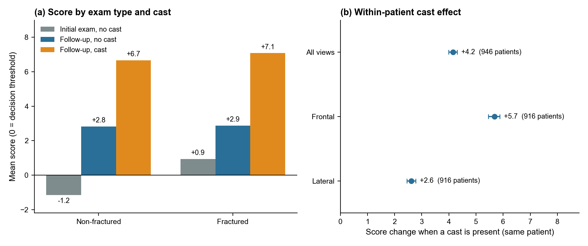
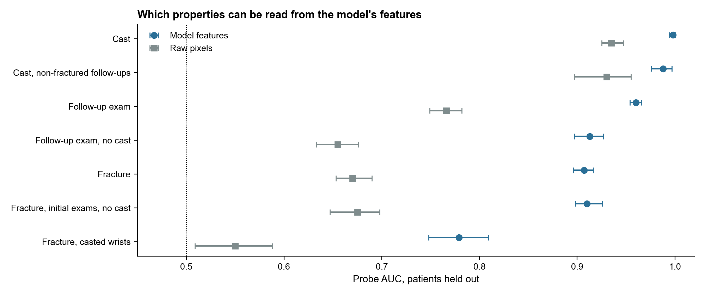
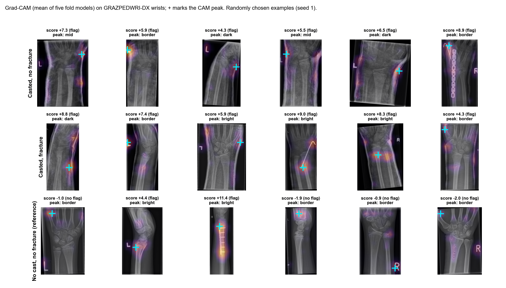
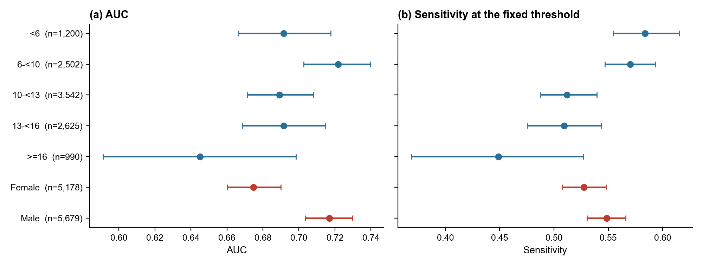

<div align="center">


</div>

# What a Fracture Detector Really Learns: A Leak-Controlled Audit

## 1. Introduction

Fracture-detection models often report an AUC above 0.9, but that number depends on how the model was tested. This research project asks what such a model actually learns. We trained a ConvNeXt-Tiny classifier on FracAtlas and kept near-duplicate images together, so no test image has a copy in training. We fixed the decision threshold on validation data first, because a threshold tuned on test data hides weaknesses. We then tested the model once on 20,327 paediatric wrist images from GRAZPEDWRI-DX, with no retraining.

The AUC fell from 0.923 to 0.825, and to 0.697 on first-visit exams, where sensitivity was only 0.540. To find out why, we compared scores within the same patient. A cast raised the score by 4.2 logits (95% CI 4.0 to 4.3), while a fracture at first presentation raised it by only about 2.1. The model therefore partly reads treatment status, not only the fracture. Small fractures and patients aged 16 and over were further weak spots. A random internal split showed none of this.

The argument rests on three ideas, leakage, shortcuts and external validation, which Section 2 defines.

---

## 2. Background

Many deep-learning fracture models report internal AUCs above 0.9 on plain radiographs. Detection models for paediatric wrist fractures report strong results [7, 8], and so do two-stage designs for subtle scaphoid fractures [9]. These results usually come from test sets drawn from the same source as the training data. Such a test cannot show whether a model works at another hospital, or whether it relies on something other than the fracture. This study tests both, and three terms frame how.

**Leakage** occurs when near-identical images of the same limb fall on both sides of a train and test split. The test then measures recall of a seen image, not detection of an unseen fracture, so the score is inflated. FracAtlas has no patient identifiers, so this study controls leakage by image similarity (Section 3).

A **shortcut** is a feature that correlates with the label in the training data but is not the property of interest [5]. Casts and implants are obvious candidates in fracture imaging, because they follow the treatment of a fracture. Image crops are a less obvious one. A shortcut can score well on a test set from the same source and still fail where the correlation breaks.

**External validation** tests a fixed model on data from another institution, population and scanner [6]. Zech et al. used it to show that a pneumonia model lost accuracy at new hospitals [6]. It is therefore the natural place for a shortcut to show itself. This study keeps the classifier deliberately standard, so its failures reflect common practice rather than an unusual model. The contribution is the audit around the model, which starts with the choice of data in Section 3.

---

## 3. Datasets and Preprocessing

The audit needs two kinds of data: a development set that marks where each fracture is, and an external set that records treatment. The development set is FracAtlas [1]. It contains 4,083 radiographs, and 719 of them show a fracture (17.6%). The images cover the leg (2,124), hand (1,281), a mixed group with several labelled body parts (398), hip (179) and shoulder (101). Every fractured image carries a bounding box, which later lets the audit check where the model looks (Section 9).

FracAtlas has no patient identifier, so the pipeline groups similar images instead. It links any two images whose 256-bit perceptual hashes differ by at most 30 bits. It also links consecutive images that are both flagged as multi-scan and share a body part, because these are likely repeat views of one limb. This produces 3,828 groups, of which 178 contain more than one image. Whole groups go to a single fold, so near-duplicates never sit on both sides of a split. The five folds are stratified by label and body part, so each fold has a similar case mix.

The external set is GRAZPEDWRI-DX [2]. It holds 20,327 paediatric wrist images from 6,091 patients. Of these, 20,215 images come from Siemens equipment and 112 from Agfa equipment. The fracture label is the dataset's `fracture_visible` field, and a blank field counts as no fracture. This gives 13,550 fractured images (66.7%).

GRAZPEDWRI-DX suits this audit because it also supplies `cast`, `metal`, `initial_exam`, age, sex and AO fracture class. These fields let the audit separate treatment from fracture. An **initial exam** is an image whose `initial_exam` field equals 1; all other images count as **follow-ups**. Every external interval resamples whole patients, because images of one patient are not independent.

Prevalence differs strongly between the two sets (17.6% against 66.7%). Metrics such as precision depend on prevalence, so they cannot be compared across the sets. The study therefore compares only AUC, sensitivity and specificity, which do not depend on prevalence.

<div align="center">

| | FracAtlas (development) | GRAZPEDWRI-DX (external) |
|---|---|---|
| Images | 4,083 | 20,327 |
| Fractured | 719 (17.6%) | 13,550 (66.7%) |
| Anatomy | leg, hand, hip, shoulder, mixed | paediatric wrist only |
| Equipment | mixed | Siemens (20,215), Agfa (112) |
| Grouping | perceptual-hash near-duplicates and multi-scan runs (3,828 groups) | patient (6,091 patients) |
| Role | five-fold training and audits | one-shot external test |

<b>Table 1.</b> The two datasets. Groups are kept within one fold and resampled in every bootstrap interval

</div>

Images are resized so that the longer side is 512 pixels and padded to 512 x 512, which keeps the aspect ratio. Training uses light augmentation, so the model cannot fit exact position or exposure. It applies rotation up to 10 degrees, scaling up to 10%, small translations, and brightness and contrast changes. It uses no flips, because laterality carries information in some views. With the data fixed, Section 4 sets out how the model is trained and tested.

---

## 4. Evaluation Design

This section fixes every training and testing choice before any test result is seen. The classifier is a ConvNeXt-Tiny [3] pretrained on ImageNet, with one input channel and one output logit. It is a standard modern architecture, which keeps the audit about common practice. It trains for up to 12 epochs with AdamW (learning rate 1e-4, weight decay 0.05), a one-cycle schedule and batch size 16. Training stops early when validation AUC has not improved for 4 epochs, which limits overfitting.

Training uses five folds so that every FracAtlas image receives a test score. For fold k, the model trains on three folds and uses fold (k+1) mod 5 for early stopping and threshold setting. It is then tested on fold k. Each FracAtlas image is therefore scored once, by the one fold model that neither trained on it nor validated on it. These out-of-fold scores support every internal result.

The **operating point** is the decision threshold, fixed before any test data is seen, because a threshold tuned on the test set hides weaknesses. For each fold model it is the 90th percentile of the scores of non-fractured validation images. This gives validation specificity of 0.899 to 0.900, approximately 90%, so about one normal image in ten is flagged. Each model's logits are shifted so that its threshold sits at zero, which puts all five models on one scale.

An image is **flagged** when its shifted score is zero or above. A flagged fractured image is **detected**, and an unflagged fractured image is **missed**.

The **five-fold ensemble** score is the mean of the five fold models' shifted logits. No fold model has seen any external image, so all five can be averaged there. The pipeline therefore uses the ensemble for every external image, with the cut-off of zero and no refitting. Internally the ensemble is never used, because the other four models trained or validated on each image. The internal headline AUC instead pools the shifted out-of-fold scores of all 4,083 images.

Every interval is a 95% percentile bootstrap with 1,000 draws that resamples whole groups. Groups are near-duplicate groups in FracAtlas and patients in GRAZPEDWRI-DX, so related images are drawn together. Two exceptions use fewer draws: the resolution test (300) and the feature-probe intervals (200). Paired comparisons of two training runs reuse the same resampled groups for both, so shared noise cancels in the difference.

<div align="center">

<p align="center">

<br>
<b>Figure 1.</b> The evaluation pipeline, from near-duplicate hashing and group splitting to the external test, the audits and the illustrative simulation
</p>
<br>

</div>

<div align="center">

<p align="center">

<br>
<b>Figure 2.</b> One detected fracture traced through the stem and the four stages of the network, ending on the Grad-CAM overlay. Stage labels are informal and the maps show mean absolute activation
</p>
<br>

</div>

Figure 2 is a single case, so it shows how the network processes an image but not where it looks in general. Sections 7 and 9 measure that across many images. Section 5 first asks how well this design performs on FracAtlas itself.

---

## 5. Internal Performance

On the leak-controlled split, the model reaches an out-of-fold AUC of 0.923 (95% CI 0.910 to 0.935). This pools threshold-shifted scores, so it is slightly generous. The raw pooled AUC is 0.911, while the mean of the five per-fold AUCs is 0.932. At the fixed operating point the model detects 581 of 719 fractures (sensitivity 0.808) at a specificity of 0.897. These internal numbers are strong, which makes the external test the real question.

A strong internal AUC could still come from a shortcut inside FracAtlas, and metal is the obvious suspect. FracAtlas marks 99 images as containing metal implants, and 97 of them are fractured. Removing them moves the AUC only to 0.915 (0.899 to 0.928), inside the interval of the full set. The hardware flag alone predicts fracture with an AUC of 0.567, while image-size class reaches 0.536. Both are close to chance, so neither explains the model's internal performance.

Leakage is the other internal risk. A naive split that ignores near-duplicate groups gave an AUC of 0.931, against 0.923 for the controlled split. The intervals overlap and each split was trained once, so this comparison shows no measurable leakage inflation. Any later gap between internal and external results is therefore unlikely to come from leakage alone.

Performance does vary with fracture size, which matters because small fractures are plausibly the subtle ones that clinicians miss (Section 11). This study defines a **small fracture** as a fractured image whose box area, relative to the image, lies in the smallest quartile. This gives 180 images. The model detects 76.1% of them (69.3 to 82.2), against 88.9% of the largest quartile (83.9 to 93.2). Section 10 asks whether this gap can be closed, while Section 6 first tests the model at a new hospital.

---

## 6. External Transfer

This section asks whether the internal result holds at a new hospital and in a new population. On GRAZPEDWRI-DX the five-fold ensemble reaches an AUC of 0.825 (0.816 to 0.833), well below the internal figure. Table 2 breaks this number down. Its first row is the 1,281 FracAtlas hand images, because hands are the closest internal match to the wrist. The other rows use the GRAZPEDWRI-DX `cast`, `metal` and `initial_exam` fields to separate treatment from fracture.

<div align="center">

| Subset | AUC | Sensitivity | Specificity |
|---|---|---|---|
| FracAtlas hand, internal | 0.899 (0.876 to 0.920) | 0.866 | 0.742 |
| GRAZ, all images | 0.825 (0.816 to 0.833) | 0.776 | 0.749 |
| GRAZ, no cast and no metal | 0.744 (0.735 to 0.753) | 0.61 | 0.79 |
| GRAZ, initial exams only | 0.697 (0.687 to 0.707) | 0.540 | 0.790 |
| GRAZ, cast present (96% fractured) | 0.560 | 0.995 | 0.017 |

<b>Table 2.</b> Internal and external performance at the operating point fixed on FracAtlas validation folds. Intervals are 95% group bootstrap (FracAtlas groups for the first row, GRAZPEDWRI-DX patients for the rest)

</div>

Treatment artefacts carry part of the headline. Removing the 6,214 images with a cast or metal leaves 14,113 images, and the AUC falls to 0.744. Initial exams alone fall further, to 0.697, with sensitivity 0.540, so the model misses nearly half of first-visit fractures. Both subsets were chosen after the results were seen. Almost no initial exam carries a cast (2 of 10,861 images) or metal (17), so the fall from 0.744 to 0.697 is not a cast effect. First-visit fractures are simply harder for this model, and Section 7 suggests why.

A low sensitivity could come from a misplaced threshold or from poor ranking, and the ranking is at fault. Refitting the threshold on GRAZPEDWRI-DX to 90% specificity still yields a sensitivity of only 0.673. This refit breaks the fixed-threshold rule, so it is excluded from the main analysis.

The ensemble matters because single models disagree externally. Scored individually, the five fold models give external AUCs from 0.753 to 0.833, while their specificity at their own cut-offs ranges from 0.356 to 0.785. A single trained model would therefore give an unstable external estimate. However, the ensemble's own cut-off of zero was never checked on held-out external data.

A change of device is another possible cause of the drop, but the data show no device effect. Only a large effect could be detected, because there are only 112 Agfa images. They give an AUC of 0.774 (0.640 to 0.892), against 0.825 for Siemens images. Within the same patient, label and view, Agfa images score 0.40 logits lower (-1.32 to +0.48), an interval that includes zero.

<div align="center">

<p align="center">

<br>
<b>Figure 3.</b> ROC curves for FracAtlas (internal, out of fold), GRAZPEDWRI-DX (external, all images) and GRAZPEDWRI-DX without cast or metal. Dots mark the operating point fixed in advance
</p>
<br>

</div>

The external curve without casts or metal lies clearly below the full external curve, so the inflation holds across nearly all thresholds. A cast is not the fracture, so Section 7 asks why it raises the score.

---

## 7. The Cast Shortcut

### 7.1 A confounded first look

This section asks whether the model reads the cast itself. GRAZPEDWRI-DX contains 5,776 casted images, and 96% of them are fractured, so a cast is almost a label in this set. The model flags 99.5% of the fractured casted wrists and 98.3% of the non-fractured ones, so on casted wrists it barely separates the labels. Its score separates cast from no cast with an AUC of 0.932, against 0.825 for fracture. The score therefore tracks the cast more closely than the fracture.

However, a pooled comparison of casted and non-casted images is confounded. All 237 casted non-fractured images are follow-up exams, and cast and initial exam are almost perfectly separated. A cast effect and a follow-up effect therefore look the same in pooled data. Figure 4a separates them by exam type.

<div align="center">

<p align="center">

<br>
<b>Figure 4.</b> (a) Mean ensemble score by label, exam type and cast. (b) Within-patient cast effect in fractured follow-up wrists, overall and by view, with 95% patient-bootstrap intervals. Zero is the decision threshold
</p>
<br>

</div>

The cells separate three steps. At initial exams without a cast, fractured images score about 2.1 logits above non-fractured ones (+0.93 against -1.16). This is the fracture signal the model should use. Among non-cast follow-ups, however, the two labels score almost the same (+2.88 against +2.83, a gap of about 0.05). Both sit above the threshold of zero, so follow-up status alone lifts the score.

A cast then adds about 4 logits for both labels. Within follow-ups, the cast raises the mean by 3.84 logits for non-fractured images (2.71 to 5.13; 244 against 237 images). For fractured images it adds 4.21 (4.04 to 4.37). The model therefore responds to treatment status, not only to the fracture.

### 7.2 Within-patient test

The cells in Section 7.1 still compare different patients, who may differ in injury and age. A within-patient design removes those differences. It pairs follow-up images of the same patient, label and view, with and without a cast. In 946 patients with fractured wrists, a cast raises the score by 4.16 logits (3.99 to 4.31). The effect is +5.68 on frontal views and +2.61 on lateral views (Figure 4b).

A patient fixed-effects regression gives a cast coefficient of +4.12 (3.97 to 4.27), so the estimate does not depend on the pairing method. The non-fractured within-patient contrast rests on only 10 patients (+6.65, 4.80 to 8.28), which is too few to rely on.

In 96% of pairs the casted exam came first, so time since injury is partly mixed into the cast effect. However, the cast effect is still about twice the fracture effect at first presentation. The score clearly moves with a cast, and Section 7.3 asks whether the features carry that information.

### 7.3 What the features encode

The within-patient test shows that the score moves with a cast, but not what the features encode. A linear probe asks which properties the model's features make readable. The probe uses the 768-dimensional pooled features of each fold model on 3,967 GRAZPEDWRI-DX images. It holds out whole patients, so it cannot succeed by recognising a patient.

<div align="center">

<p align="center">

<br>
<b>Figure 5.</b> Patient-held-out probe AUC for cast, follow-up status and fracture, on model features and on raw pixels, with 95% patient-bootstrap intervals
</p>
<br>

</div>

The features encode cast almost perfectly (AUC 0.998). They encode follow-up status at 0.960, and still at 0.913 among non-casted images, so follow-up status is readable without a cast. Fracture reaches 0.907 overall but only 0.779 among casted images, so a cast hides the fracture signal. Raw pixels already read cast at 0.935, as expected for so visible an object. A probe therefore shows that cast is readable, not that the classifier uses it. Section 7.4 looks for use through the classifier's own gradients.

### 7.4 Grad-CAM on casted wrists

Grad-CAM [4] highlights the regions that raise the classifier's score, so it tests use rather than readability. Grad-CAM from the five fold models was averaged on 600 GRAZPEDWRI-DX images, half casted and half not. Each image was split by intensity into dark (air), mid (soft tissue) and bright (bone-like) regions. On casted wrists, the share of the top 10% of CAM mass on bright pixels falls from 0.356 to 0.226. The difference is -0.13 (-0.16 to -0.10), while the bright area stays about 19% in both groups, so area does not explain the shift. The intensity split cannot separate plaster from bone, however, so this is a correlate.

<div align="center">

<p align="center">

<br>
<b>Figure 6.</b> Grad-CAM (mean of the five fold models) on random GRAZPEDWRI-DX wrists: casted without fracture (top), casted with fracture (middle) and non-casted without fracture (bottom). The cross marks the CAM peak
</p>
<br>

</div>

In Figure 6 every casted image is flagged, including all six without a fracture. On casted wrists the heat often runs along the cast shell and the edge of the limb. In 9 of the 12 casted examples the peak falls on a border, dark or mid region rather than on a bright, bone-like region. However, peaks in the reference row also often sit at the border, sometimes on a side marker, so border peaks are not unique to casts. Two reference images are flagged, and one of them carries a metal plate (score +11.4). The sheet illustrates the pattern; the 600-image contrast above measures it.

### 7.5 Perturbations

Grad-CAM only observes the model, so perturbations change the image to test which content drives the high casted scores. Gaussian blur with sigma 4 lowers casted scores by 5.6 logits, against 1.3 for non-casted images. Masking the outer 10% border lowers them by 2.0, against 0.7. Fine texture and peripheral content therefore carry much of the casted score.

The other results are weaker. Masking the brightest 5% of pixels does not remove the effect, but every flat mask raises scores, including a shifted control mask. This test is therefore limited by a mask artefact. Even after blur or border removal, 83% to 97% of casted images stay flagged. The perturbations are suggestive, not causal.

### 7.6 Where the shortcut was learned

The model was trained only on FracAtlas, so a cast cue it learned most likely came from there. FracAtlas has no cast field, so one reader inspected FracAtlas images. The reader was an AI model, not a radiologist. Casts or splints appeared in 16 of 60 random fractured images and in 1 of 60 correctly rejected non-fractured images (p < 0.001). In FracAtlas, a cast is therefore close to a fracture label.

If the model leaned heavily on casts within FracAtlas, casts would be common among its false alarms. Among the 60 highest-scoring false alarms, only 5 showed a cast (against 1 of 60, p = 0.21). Metal, mostly external objects such as bangles and watches, was more common among false alarms (14 against 3, p = 0.007). External metal is therefore a second candidate cue. FracAtlas plausibly taught the cast cue, but this study does not prove that the GRAZPEDWRI-DX behaviour comes from it.

Treatment is not the only factor that could move performance, so Section 8 checks the others.

---

## 8. View, Fracture Type, Age and Sex

This section checks view, fracture type, age and sex on first-visit exams, where the cast and follow-up effects are absent. View matters most. Frontal views give an AUC of 0.61 and a sensitivity of 31% (5,370 images), against 0.79 and 73% for lateral views (5,439 images). The model therefore misses most first-visit fractures on frontal views.

Many studies have both views, so combining them might recover those misses. It did not. On 4,951 first-visit studies with both views, the lateral view alone gives 0.785 (0.771 to 0.797), against 0.580 for the frontal view. The maximum of the two scores gives 0.775 and their mean 0.743, so adding the frontal view only dilutes the lateral one.

Sensitivity also varies by fracture type. By AO class, first-visit sensitivity is 51% for the most common class, 23r-M (3,173 images). It is 67% for 23-M, 49% for 23r-E and 79% for 22r-D (62 images). Counts are images; only classes with at least 30 patients are shown, because smaller classes give unstable estimates.

Age and sex were tested on no-cast initial exams, so that treatment effects cannot mask them.

<div align="center">

<p align="center">

<br>
<b>Figure 7.</b> AUC (a) and sensitivity at the fixed threshold (b) on no-cast initial exams, by age band and sex, with 95% patient-bootstrap intervals
</p>
<br>

</div>

Every subgroup in Figure 7 lies between AUC 0.645 and 0.72, so no group escapes the first-visit weakness. Sensitivity falls steadily with age, from 0.58 under 6 years to 0.45 at 16 and over, the group with the lowest AUC. The reason for the age trend is uncertain. Males reach an AUC of 0.717 against 0.675 for females, and their intervals do not overlap. These subgroups show where the model fails; Section 9 asks whether it uses the fracture when it succeeds.

---

## 9. Where the Model Looks on Fractures

The cast audit shows what else the model uses. This section asks whether it also uses the fracture itself. That question needs fracture boxes, so the audit returns to FracAtlas. For each fractured image, Grad-CAM is computed on the last stage of the fold model that scored it, which never trained on that image. The audit records whether the heatmap peak falls inside the box, enlarged by 16 pixels on each side to allow for small misplacement.

The peak falls inside the box for 63.7% (59.6 to 67.8) of the 581 detected fractures, against only 29.7% (22.3 to 38.1) of the 138 missed ones. A uniformly placed peak would land in the enlarged box about 3% of the time. This chance level is generous to the model, but both rates still lie far above it. Detected fractures are therefore usually found in the right place, and missed ones usually are not.

Heatmaps only show association, so an occlusion test checks the same question by intervention. Covering the fracture with the image's median grey lowers the score by 2.42 logits on average (2.13 to 2.72). Covering up to five same-sized control patches on bright areas away from the fracture raises it by about 0.01 logits. Covering the fracture lowers the score more than the control patches in 77% of cases (73 to 80%). However, 86% of these images are still flagged after the fracture is covered.

<div align="center">

<p align="center">

<br>
<b>Figure 8.</b> Correctly detected fractures, randomly sampled, with the annotated box in green and the Grad-CAM overlay below
</p>
<br>

</div>

<div align="center">

<p align="center">

<br>
<b>Figure 9.</b> Missed fractures (fractured images scored below the operating point), randomly sampled
</p>
<br>

</div>

<div align="center">

<p align="center">

<br>
<b>Figure 10.</b> The six highest-scoring non-fractured images, which are the model's most confident false alarms
</p>
<br>

</div>

In Figure 8 the heatmaps of detected fractures tend to sit on the box, while in Figure 9 those of missed fractures often do not. On average the model therefore uses the fracture region, but the fracture alone does not carry the decision. The fracture is hardest to use when it is small, which Section 10 examines.

---

## 10. Small Fractures

Section 5 showed that small fractures are detected less often (76.1% against 88.9%). This section asks whether a simple change to the input or the training closes that gap. The primary metric is sensitivity on the 180 small fractures at the fixed operating point. Every run uses the same folds, so runs differ only in method.

Resolution was tested first, because small fractures might simply be lost when images are downsized to 512 pixels. Reducing images to 128 pixels and restoring them to 512 lowers the AUC from 0.923 to 0.850, mostly through false alarms. However, small-fracture sensitivity does not fall (0.76 native, 0.77 to 0.80 degraded), and upscaling the input to 640 or 768 pixels adds nothing. Resolution is therefore not the bottleneck at this scale.

Three interventions were tested, each aimed at making the model attend to the fracture or see more small ones. The first is an auxiliary head that predicts a coarse fracture-location map during training only. It is supervised with boxes on 100%, 25% or 10% of fractured training images, to test how many boxes are needed. The second is a finer version of that head. The third oversamples small fractures three-fold.

Each box run has a matching control that trains the same head without boxes, so any gain can be credited to the boxes rather than the head. The unmodified baseline was trained with seeds 42 and 43 on the same folds, to measure how far a result moves by chance alone.

A decision rule was written down before the fine head, its control and the oversampling run were trained, so the results could not shape the criterion. An intervention counts only if its paired 95% interval lies above zero against both baseline seeds. It must also lose no more than 0.01 AUC or 0.03 specificity. The three box runs and the first control had already been seen, so they are exploratory. The rule was tightened once, after the seed-43 baseline appeared. Table 3 compares every run with the seed-43 baseline, because it is the stronger of the two and so the harder test.

<div align="center">

| Run | AUC | Small-fracture sensitivity | Difference from seed-43 baseline |
|---|---|---|---|
| Baseline, seed 42 | 0.923 | 0.761 (0.693 to 0.822) | |
| Baseline, seed 43 | 0.932 | 0.794 (0.735 to 0.854) | |
| Auxiliary head, no boxes (control) | 0.935 | 0.806 | +0.011 (-0.033 to +0.052) |
| Boxes on 100% of fractured images | 0.936 | 0.833 (0.773 to 0.885) | +0.039 (-0.005 to +0.078) |
| Boxes on 25% | 0.932 | 0.800 | +0.006 (-0.043 to +0.051) |
| Boxes on 10% | 0.938 | 0.828 (0.769 to 0.886) | +0.033 (-0.018 to +0.078) |
| Fine head, boxes on 100% | 0.939 | 0.828 (0.770 to 0.881) | +0.033 (-0.013 to +0.080) |
| Fine head, no boxes (control) | 0.936 | 0.794 | +0.000 (-0.045 to +0.045) |
| Oversample small x3 | 0.932 | 0.761 (0.688 to 0.826) | -0.033 (-0.086 to +0.015) |

<b>Table 3.</b> Out-of-fold AUC and sensitivity on the 180 small fractures at the fixed operating point. Differences are paired, with 95% group-bootstrap intervals

</div>

No run passes the rule. No interval clears zero against seed 43, and no box run clearly beats its own no-box control. The closest is the fine head with boxes, at +0.033 over its control (-0.010 to +0.076). However, the direction is consistent across comparisons.

For the six auxiliary-head and box runs, gains range from 0.000 to 0.039 against seed 43 and from 0.033 to 0.072 against seed 42. Against the mean of the two baselines they gain 0.017 to 0.056, a comparison chosen after the results were seen. Oversampling, in contrast, gains -0.033, 0.000 and -0.017 under the three comparisons. Box supervision may therefore help a little, but this design cannot confirm it.

<div align="center">

<p align="center">

<br>
<b>Figure 11.</b> Small-fracture sensitivity by run, with 95% intervals. The shaded band spans the two baseline seeds
</p>
<br>

</div>

The seed band in Figure 11 is the main result of this section. The two baseline seeds differ by 0.033 with no change to the method, and 18 of the 180 images changed outcome. Seed variation is therefore as large as the gains under test. The paired 95% half-width on 180 images is about 0.045, so only differences of about 0.065 or more are detectable in principle. The rule therefore stopped three single-seed wins against seed 42 from being reported as findings. Section 11 uses the measured small-fracture sensitivity to ask what these numbers mean in an emergency department.

<div align="center">

<p align="center">

<br>
<b>Figure 12.</b> Small fractures, three detected (left) and three missed (right), randomly sampled
</p>
<br>

</div>

<div align="center">

<p align="center">

<br>
<b>Figure 13.</b> A detected and a missed small fracture. The annotated box appears first and the Grad-CAM heatmap follows. In the missed case the heatmap peak lies away from the box
</p>
<br>

</div>

---

## 11. Illustrative ED Simulation

This section asks what the gap between the internal and external operating points would mean in an emergency department (ED). A discrete-event simulation translates both points into missed fractures and workload. It models one typical English major (Type 1) ED for a year, averaged over 10 simulated years to smooth random variation. Only the national volume is sourced, from NHS England data (1.503 million Type 1 attendances in September 2026). The other inputs are assumptions, so the output is a comparison, not a forecast.

The assumed inputs include 120 departments, about 49 limb X-rays a day and a fracture prevalence of 20%. They also include a **usual miss rate** of 5% by the ED clinician before the radiology report. An AI alert on a missed fracture leads to correction with probability 0.8.

The simulation compares two uses of the model. As an **alert**, a flagged image prompts a re-read while the patient is still in the ED. As **triage**, flagged images move to the front of the reporting queue. The fractures an ED misses are likely to be subtle, so the simulation uses the small-fracture sensitivity of 0.761 as a proxy at the internal point. For the external point it scales this by the first-visit loss, giving 0.509 (0.54 x 0.761 / 0.808).

Under these assumptions the ED misses about 182 fractures a year. The internal point (sensitivity 0.81, specificity 0.90) catches 109 of them, at about 12 extra re-reads a day, of which 4 are false alarms. The external first-visit point (sensitivity 0.54, specificity 0.79) catches only 71, at 13.5 re-reads a day, of which 8.2 are false alarms. The external point therefore catches fewer misses and costs more false alarms.

Triage helps most when the reporter is busy, because queue position matters only when a queue forms. At 95% reporter load, the internal point lowers undetected fracture-hours from 1,760 to 1,110 a year.

<div align="center">

<p align="center">

<br>
<b>Figure 14.</b> Illustrative ED simulation at a 5% usual miss rate, comparing the internal and external operating points. A comparison of assumptions, not a prediction
</p>
<br>

</div>

Planning around the internal figure would therefore overstate caught misses and understate false alarms. The simulation code can calibrate arrivals and reporting times from a site's timestamps. However, it becomes a site model only after calibration and validation on real local data.

A companion break-even analysis asks the same question in cost terms. It computes the highest cost-neutral price per scan over a 5 x 5 grid of unsourced values. The grid varies the cost of a missed fracture and the usual miss rate. At a 10% miss rate and a cost of 1,000 per miss, the price is 3.2 at the external point against 12.6 at the internal point. The external price is negative in 11 of 25 cells, against 5 for the internal point. A negative price means the tool would not break even even if it were free.

<div align="center">

<p align="center">

<br>
<b>Figure 15.</b> Illustrative break-even grid. Costs and usual miss rates are axes, and none of the values are sourced
</p>
<br>

</div>

Both analyses therefore point the same way. Under these assumptions, external performance, not internal performance, decides whether a fracture AI is viable.

---

## 12. Discussion

One model, measured four ways, gives answers that differ by more than their confidence intervals. The AUC is 0.923 on FracAtlas and 0.825 on GRAZPEDWRI-DX, and it falls to 0.744 without casts or metal and 0.697 on first-visit exams. Part of this drop is a task change, from mixed adult anatomy to paediatric wrists. However, a random split of the source data would reveal none of it, so the internal number alone would mislead.

Inside the same patient, a cast raises the score by about 4 logits, while a fracture at first presentation raises it by about 2. Follow-up exams without a cast also score high, whatever their label. The features encode cast almost perfectly, Grad-CAM moves off bone on casted wrists, and blur removes much of the casted score. Treatment status is therefore the largest single effect on the score. Together these findings fit a cast and treatment cue, although none of them alone proves the mechanism.

This shortcut matters in practice because no cast exists at first presentation, and that is where the model is weakest. External results should therefore be reported with and without treatment artefacts. The first-visit figure (0.697) is the fairer headline for a triage use case, because triage happens at first presentation.

The fracture-level audits on FracAtlas support the model on average, because heatmaps and occlusion agree that it often uses the fracture region. However, most images stay flagged after the fracture is covered, so the fracture is not the whole story.

The small-fracture experiments are a finding about measurement. With two seeds and 180 images, a gain of a few points cannot be separated from seed variation. Published comparisons of similar size that report one training run therefore deserve the same caution.

---

## 13. Contributions

1. **A fully open, leak-controlled evaluation pipeline.** Near-duplicate radiographs are grouped before splitting, and every FracAtlas image is scored by a model that never saw it. The threshold is fixed on validation data and never refitted, including on the external set, so no reported result is tuned to its test data.

2. **An audit of what the detector relies on.** Within-patient tests, feature probes, Grad-CAM and perturbations expose a cast and treatment shortcut. This shortcut moves the score more than a fracture does at first presentation. The audit also exposes collapse on first-visit exams and weak performance on small fractures and older patients.

3. **A measured account of what the data can resolve.** The pipeline releases a pre-written decision rule, a seed-variance check, a resolution test and an illustrative ED simulation as code. Any other fracture model can therefore be put through the same questions.

---

## 14. Limitations and Future Work

This is a retrospective study on public data, and it makes no clinical claim. Every setting was trained once, with one extra seed for the baseline only. Run-to-run variance is therefore not estimated, and single intervals understate the uncertainty.

FracAtlas has no patient identifiers. Leakage between images of one patient that the hash grouping missed remains possible. The naive-versus-controlled comparison cannot measure its size. FracAtlas mixes body parts and contains only 381 fractured hand images, so the closest internal match to the wrist is small.

GRAZPEDWRI-DX is paediatric and wrist-only. Its 112 Agfa images can rule out only very large device effects. Images with a blank `initial_exam` field were treated as follow-ups. The provenance of the `fracture_visible` label was not checked. The licence terms of both datasets have not been verified and should be checked before any redistribution.

The cast, view, fracture-type, age, sex and device analyses are post hoc. So are the 0.744 and 0.697 subsets, which therefore describe these data rather than test a prior hypothesis. The five-fold ensemble's cut-off of zero was never checked on held-out external data. The cast effect remains partly mixed with time since injury, because the casted exam came first in 96% of pairs. The non-fractured within-patient contrast rests on 10 patients.

The probe shows that information is readable, not that the classifier uses it. The Grad-CAM intensity split cannot separate plaster from bone. Perturbations push images off the training distribution, and the bright-pixel mask is limited by a mask artefact. The occlusion control patch is chosen by brightness and may not lie on bone. The FracAtlas visual audit used one reader, an AI model and not a radiologist, on 512-pixel images, with no second reader. The reader knew that the random set was fractured, which may raise its cast count.

The small-fracture decision rule was self-timestamped, not externally registered, and was tightened once. The ED simulation rests on assumptions, and the break-even values are unsourced. Neither is evidence of clinical benefit.

The most useful extensions follow from these limits. A same-wrist counterfactual test, with and without a cast, would establish the shortcut causally. Training with treatment-balanced data, or with casted images excluded, would show whether first-visit accuracy improves. The small-fracture test needs three to five seeds per arm. Training at higher resolution, on paired views or with GRAZPEDWRI-DX patients was not tried. Prospective multi-site evaluation remains the standard for any such system.

---

## 15. Repository Layout and Reproduction

All code lives in `FractureDetection/` in this repository. The `fracai/` package holds the library code: data, split, training, metrics, audit, Grad-CAM, break-even and simulation. The `scripts/` folder has one subfolder each for data preparation, training, audits, analysis and simulation. The `jobs/` folder holds the resumable shell runners. The `docs/` folder holds the analysis plan, limitations, data licence notes and the paper draft. The test suite has 28 tests, run with `pytest`, and `ruff` passes.

```
cd FractureDetection
python -m venv .venv
.venv/Scripts/python -m pip install -r requirements.txt
```

Run every script from the `FractureDetection` folder with `PYTHONPATH=.`. The order is the data scripts, then `bash jobs/run_training.sh`, then the box and audit scripts. The control and small-fracture runs, the analysis scripts and the simulation follow. The shortcut audit runs with `bash jobs/run_audits.sh`. It calls `scripts/analysis/a1_cast_within_patient.py`, `a2_age_sex.py` and `a3_device.py` on the saved external scores. It then calls `scripts/audit/b1_feature_probe.py`, `b2_cam_cast.py` and `b3_perturb.py` on the saved fold models, and `scripts/analysis/audit_figures.py` for the figures. The FracAtlas visual audit uses `scripts/analysis/cast_contact_sheets.py`, `cast_contact_sheets_fxrand.py` and `cast_annotation_summary.py`.

Datasets and model weights are not included and must be downloaded from their original sources. The reported numbers were recomputed from the saved score files by an independent check. A full retraining from scratch has not been repeated.

---

## 16. References

1. Abedeen et al. (2023). FracAtlas: A Dataset for Fracture Classification, Localization and Segmentation of Musculoskeletal Radiographs. Scientific Data 10.
2. Nagy et al. (2022). A pediatric wrist trauma X-ray dataset (GRAZPEDWRI-DX) for machine learning. Scientific Data 9.
3. Liu et al. (2022). A ConvNet for the 2020s. CVPR 2022.
4. Selvaraju et al. (2020). Grad-CAM: Visual Explanations from Deep Networks via Gradient-Based Localization. International Journal of Computer Vision 128.
5. Geirhos et al. (2020). Shortcut learning in deep neural networks. Nature Machine Intelligence 2.
6. Zech et al. (2018). Variable generalization performance of a deep learning model to detect pneumonia in chest radiographs: a cross-sectional study. PLOS Medicine 15.
7. Ju and Cai (2023). Fracture detection in pediatric wrist trauma X-ray images using YOLOv8 algorithm. Scientific Reports 13.
8. Zech et al. (2023). Detecting pediatric wrist fractures using deep-learning-based object detection. Pediatric Radiology 53.
9. Yoon et al. (2021). Development and Validation of a Deep Learning Model Using Convolutional Neural Networks to Identify Scaphoid Fractures in Radiographs. JAMA Network Open 4.

---

## Author

Navin Bondade
Researcher, University College London
